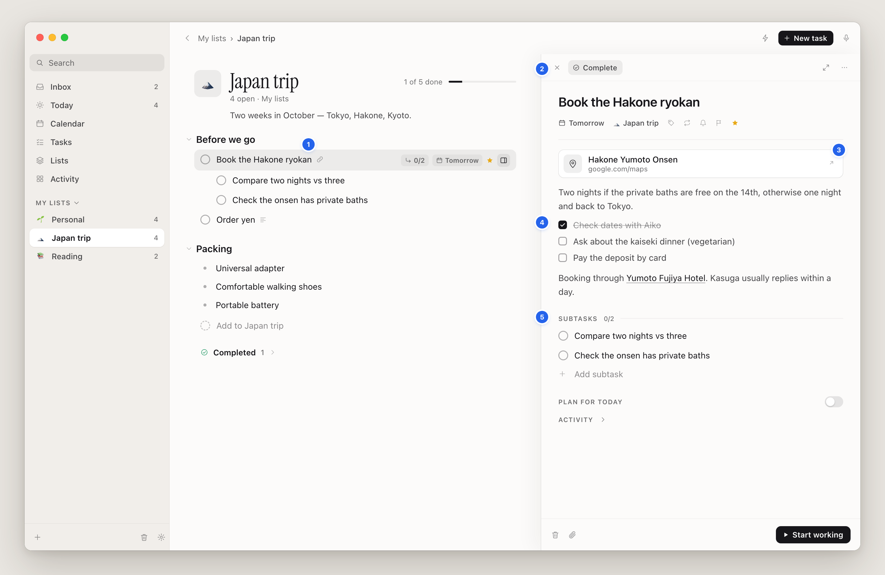
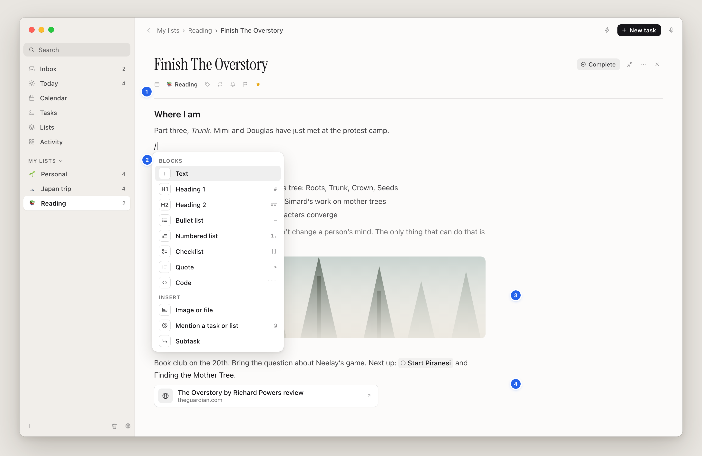
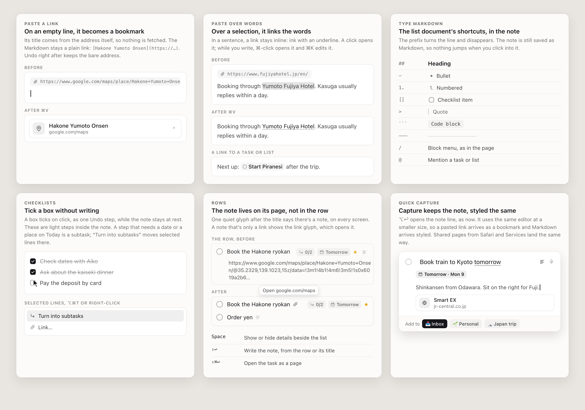
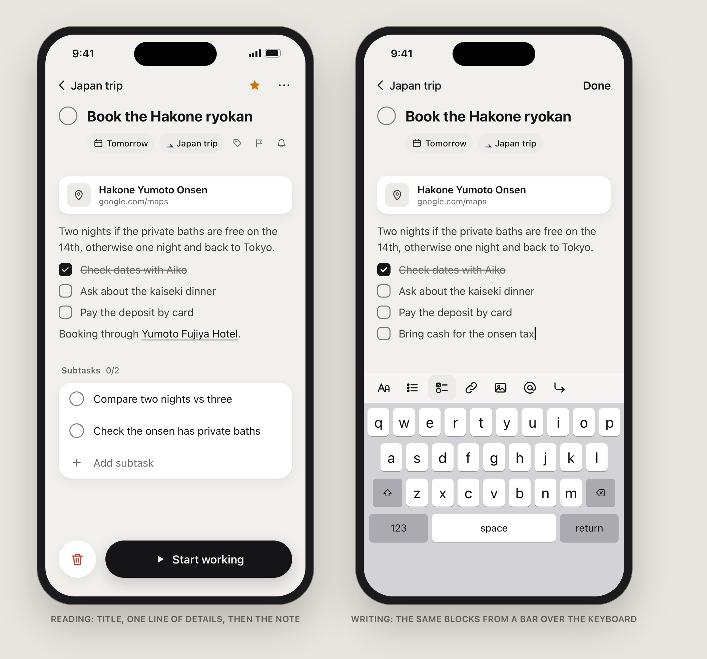

# Task notes: a task is a page

Design proposal, 2026-11-08. The owner approved phases 1–3 the same day; their decisions are in §8. The mockups sit beside this file as `1-…4-*.png`.

## In short

- **Why it feels sloppy:** notes were added to rows as a second, simpler editor. Markdown is only half supported: it's styled in the inspector but shows raw everywhere else. Each surface also has its own way to reach the note (a hint glyph, a hover button, Space, ⇧↩, a raw preview line).
- **The fix:** a task opens as a page. The page is the one place to read and write its note, as a roomy document. Rows stay one line, with one quiet glyph when a task has a note.
- **One editor and one renderer everywhere.** Markdown shortcuts, a `/` block menu, real checkboxes and clickable links. A pasted link becomes a bookmark (or a link over selected words), images go inline, and `@` mentions tasks and lists.
- **Details beside the list, or as a full page:** Space or double-click opens details in a wider panel beside the list, and ⇧⌘↩ opens the task as a full page. Both are the same layout: title, then one quiet line of details, then the note, then subtasks.
- **Data model:** keep `Block.note` as Markdown. Don't move task bodies to child blocks. This means no migration and no MCP, sync or search changes, and subtasks stay as they are.
- **First step:** clean rows plus a single note surface, about 1–2 days. It removes most of the "slop" before the new editor work starts.

---

## 1. Audit: what's there today

**Method.** I built the Dev app from `main` (4de7b6e) and made a review copy with `OpenlistReviewSession=task-notes-audit`, so it ran on sample data in light mode. I seeded six realistic notes:

- a link-only Google Maps note, set up like the owner's screenshot (0/2 subtasks, Tomorrow, starred)
- a Markdown note with a checklist
- a long reading note with headings, bullets, a quote, links and a code fence
- a one-line note
- an Inbox note with a Markdown link
- a short plain note

I then went through adding, showing, editing and opening notes in the list document, the inspector, the page, Today, the Inbox and quick capture.

- **1. Rows turn into documents, raw.** An open note is drawn with `Text(task.note)`, so it shows raw: a 130-character Maps URL over two lines, `**¥80,000**`, `- [x]`, `- [ ]`. It also sits *between* a task and its subtasks and pushes them down. This is the owner's screenshot.
- **2. Two note glyphs on one row.** A folded note shows a glyph after the title. On hover, a second, identical glyph appears among the chips (the note button), which turns accent-coloured while the note is open. Space, ⇧↩, the button and a click on the shown note each do slightly different things (show, hide, start, edit).
- **3. One note, two looks, on one screen.** On the left the row shows `## Where I am`, `*Trunk*`, `[Finding the Mother Tree](https://…)` and the ```` ``` ```` fences. The inspector on the right styles the same note. The 360pt inspector makes long notes a narrow column, and the subtasks fall below the fold.
- **4. Two editors.** Editing in the row uses `NXNoteTextView`: 13pt plain text with no Markdown styling and no list continuation. The inspector uses `NXInspectorTextView`, which has both. Even the placeholders differ: "Add a note…" in the row, "Add notes…" in the inspector, "Note" in capture.
- **5. Links don't open, and editing makes the text jump.** Clicking the underlined link puts the caret in the URL instead of opening it. When the field takes focus, every Markdown marker reappears (`**`, `- [x]`), so the text reflows under the pointer. Checkboxes are faint `[ ]` text: you can't tick one without typing an `x`.
- **6. The page is close but unfinished.** Bullets are faint hyphens. The quote is grey text with no rule. Hidden code fences leave blank lines, and the code fill only covers the text. Headings sit right on top of their paragraph. The note is 720pt wide but the sections run to the window edge, so the Subtasks rule and the Plan toggle don't line up with the body.
- **7. Notes disappear on other screens.** Today and Tasks show no hint that a task has a note (three of these do). Label screens, the Inbox list and a list's Completed group show a raw one-line preview (`NXRowOptions.notes`).
- **8. Triage shows raw Markdown** (`[membership page](https://example.com/membership)`).

From the code:

- **⇧↩ never reached the note from a line being written.** macOS binds no key to Shift-Return, so it arrives as Return's `insertNewline:` and made a new line; only ⌃↩ reached the note.
- **Export flattens notes.** It writes each note as a `> ` quote and escapes every Markdown character (`MarkdownExporter` calls `InlineMarkdown.escape`). Exported checklists, headings and links become backslashed literals, and URLs turn into `https://wise\.com/…`.
- **No images in notes.** Dropped files go to a separate Files list.
- **No `/` menu, no paste-to-link and no mentions in notes**, although the list document has a `/` menu.
- **Copied task links only work on this Mac.** `openlist://v1/<library>/task/<id>` links are tied to one library, so a task link pasted into a note won't open on the iPhone.
- **iPhone.** The note is a plain `TextField` placed *above* When, Priority, List and Labels, which breaks the "notes after the details" rule. Markdown isn't rendered there, links can't be tapped, and rows give no hint that a note exists.
- **Accent overuse.** The open-note button, links and the caret all use the accent. Under the 2026-11-08 monochrome direction, these become ink.

## 2. What to take from Notion and Linear

| Pattern | Seen in | Take it? | In Openlist |
|---|---|---|---|
| A record opens as a page with a free body | Notion pages, Linear issues | **Yes** | The task page: title, one quiet details line, then the note as a document. |
| Side peek beside the list | Notion side peek, Linear's Space peek | **Yes** | The inspector becomes a wider panel beside the list (520pt, resizable). Space toggles it, as Quick Look does in Finder, and J/K move it along (it already follows focus). |
| Clean rows: title plus properties, never the body | Linear | **Yes** | Rows never expand a note. One quiet glyph means "has a note". |
| `/` block menu | Notion, Linear | **Yes** | The list document's slash card, with Markdown shortcuts shown beside each item. |
| Markdown shortcuts as you type | both | **Yes** | The list document's prefixes: `#`, `##`, `-`, `1.`, `[]`, `>`, ```` ``` ````, `---`. |
| Paste a URL over selected text to link it, ⌘K | both | **Yes** | As is. |
| Pasted URL → bookmark, embed or mention | Notion's paste menu | **Partly** | No menu. A URL alone on a line becomes a bookmark, a URL in a sentence becomes a link, and an Openlist link becomes a mention. Undo goes back to the plain URL. |
| Fetching page titles and previews | Notion, Linear unfurls | **Later, opt-in** | Titles come from the URL itself (Maps place names, path words), so nothing goes to the network. Fetching titles could be an opt-in setting. |
| `@` mentions | both | **Yes, tasks and lists** | Inserted as `[Title](openlist:task/<uuid>)`, which works on every device. |
| Description stored and exchanged as Markdown | Linear's API | **Yes** | `Block.note` stays Markdown, and MCP keeps reading and writing it. |
| Sub-issues listed after the description | Linear | **Yes** | Subtasks follow the note on the page. |
| Every line is its own block (drag handles, block comments) | Notion | **No** | Too heavy for a task note. See §5. |
| Properties panel to the side | Linear | **No** | The owner's order is one quiet details line under the title. |
| Inline toggles, callouts, tables, databases | Notion | **No** | Not needed for task notes. |

## 3. The proposal on the Mac

### Principles

1. **A task is a page.** The page is the only place a note is read or written. It has two widths: details beside the list, or the full page.
2. **Rows stay one line.** They show a title, chips and at most one quiet glyph.
3. **One renderer and one editor.** Wherever a note's text shows (page, details panel, capture, triage, search snippets, iPhone), it's drawn from the same Markdown in the same way.
4. **Markdown underneath, never on screen.** Syntax is hidden except inside the span you're editing, so clicking in never moves the text.
5. **Monochrome.** Ink for links, the caret, focus and the one primary action, and grey fills for selection and hover. Colour only means something: overdue, done, priority, a list's own icon. The star stays amber unless the `linear-minimal` work changes it.

### Viewing

**Rows (every screen).** After the title, one glyph in quaternary ink, and only if the task has a note:
- `text.alignleft`: the note has text. Clicking it opens details with the caret in the note.
- `link`: the whole note is one link. Clicking it opens the link, and the tooltip names it ("Open google.com/maps").

This replaces the folded-note hint, the hover note button, the inline note, and the one-line previews on label, Inbox and Completed rows. Today and Tasks get the glyph too.

**Details beside the list ([mockup 1](1-rows-and-peek.png)).** This is today's inspector, widened to 520pt and resizable (420–720, remembered). In a narrow window it gives way, down to 360pt, so the list keeps at least 360pt beside it. It opens with Space, Return, double-click or the row's open icon. It shows:
- the title
- one quiet line of details (date, list, labels, repeat, reminder, priority, star)
- a hairline, then the note
- Subtasks (count in the header), then Files (only files the note doesn't show inline), then Plan, then Activity (folded)

**Page ([mockup 2](2-page-and-slash-menu.png)).** ⇧⌘↩, as now. It's left-aligned in the page column, per the owner's rule. The header (serif title, controls) spans the column. The note and every section under it share one 680pt reading measure, so the rules, toggles and text line up.

**The note as a document.**
- Headings get room above them. Bullets and numbers are drawn, with hanging indents.
- Checklists use **square** boxes, so they don't look like tasks, which have round boxes. A click ticks a box at rest, as one Undo step.
- Quotes get a 2pt rule. Code is a full-width block with a fill. Dividers are drawn.
- Links are ink with an underline and open on click. While you're writing, ⌘-click opens them.
- A link alone on a line shows as a **bookmark**: an icon, a title derived from the URL, and the domain.
- Images show inline at column width. Double-click opens Quick Look.
- Mentions are chips (a task shows its checkbox state, a list its glyph).

**Long notes** scroll inside the details panel, and the page is where you read them at length. Subtasks always follow the note. The row's `0/2` chip already shows progress, so nothing needs repeating above the note.

### Entering

**Starting a note:**
- **From a row:** ⇧↩ while the row is focused or while writing its title (today's "Note" shortcut) opens details with the caret at the end of the note. The row's context menu and the Task menu get **Add Note** / **Edit Note**. Clicking the row's note glyph opens the details to read it.
- **From the details panel or the page:** click anywhere in the empty room under the details line. The placeholder reads "Add a note…". On an empty focused line, a faint "Type / for blocks" shows, as in Notion. Tab from the title goes to the note, and ⇧Tab at its start goes back.
- **From the keyboard:** a **Task ▸ Edit Note** menu item (⇧↩) does the same as above.
- **From quick capture:** ⌥↩ opens the note line, as now, but it uses the same editor at a smaller size. A pasted link arrives as a bookmark, and Markdown arrives styled. The Share sheet, Services and voice put their text in the note the same way.

**Writing ([mockup 3](3-entering.png)):**
- **Markdown shortcuts:** the list document's prefixes. The prefix turns the line into that block and disappears.
- **`/` menu:** shows the shortcut beside each block. It ends with Image or file, Mention, and **Subtask**. Subtask adds a real task to the Subtasks section, not a line in the note.
- **Paste a URL on an empty line** → bookmark. **Paste a URL over selected words** → link. **⌘K** adds or edits a link. **Paste an Openlist link** → mention. ⌘Z right after any paste puts back the plain URL.
- **Paste or drop an image** → inline image. **Drop another file** → a file chip.
- **Return** continues a list, and Return on an empty item ends it. **Tab and ⇧Tab** indent list items (elsewhere Tab still leaves the note, as now).
- **Formatting:** ⌘B, ⌘I, ⌘⇧X (strike), ⌘E (code). ⌘⇧7, ⌘⇧8 and ⌘⇧9 make numbered lists, bullets and checklists.
- **Turn into subtasks:** on selected checklist lines, this moves them to real subtasks. Checklists are light steps inside a note. A step that needs a date or a place on Today is a subtask.
- **Finishing:** Esc or ⌘↩ finishes, and the row keeps focus. The whole edit is one Undo step with an Activity entry, as now.

### Keys

| Key | Where | Does |
|---|---|---|
| Space | focused row | Show or hide details beside the list (replaces "show note in place") |
| ↩ / double-click | row | Open details |
| ⇧↩ | row, or its title being written | Open details with the caret in the note |
| ⇧⌘↩ | row or details | Open as a page or go back, as now |
| J / K | with details open | The details follow the focused row (already true) |
| Esc / ⌘↩ | in the note | Finish; the next Esc closes the details |
| ⌘K, ⌘B/I/E, ⌘⇧X, ⌘⇧7/8/9 | in the note | Link, bold/italic/code, strike, numbered/bullet/checklist |

Key caps stay in tooltips and menus, per the owner's rules. No button shows one.

### What goes away

- `NXDocumentNote`, `NXNoteEditor` and `NXNoteTextView` (the row editor)
- the row's note button
- `Workbench.openNotes` and its saved state, and the note-in-place uses of `editingNoteID` and `noteEdit`
- the `NXRowOptions.notes` preview line
- `TaskNoteLinks`, the buttons under the inspector note, since the note's own links and mentions now open

## 4. iPhone ([mockup 4](4-iphone.png))

- **Task detail order:** title, then **one line of chips** (When, List, Labels, Priority, Reminder), then the note, then Subtasks, then Plan, then History. A chip opens the menu or sheet that its field row opens today. Unset fields show as a faint icon only. This fixes the current order, where the note sits above the fields.
- **The note** is a `UITextView` using the same Markdown styling as the Mac. Boxes tick and links open with a tap at rest, and a tap elsewhere starts writing.
- **While writing,** a bar over the keyboard offers: Aa (text style), bullets, checklist, link, photo, @mention, and Subtask. **Done** in the top bar finishes, as now.
- **Rows** get the same note glyph after the title.
- **Capture and the Share extension:** the capture note line and the Share extension's note use the same styling, so a shared URL arrives as a bookmark.
- **Triage cards** show the note styled, three lines at most.

## 5. Data model: keep Markdown in `note`, or make the body child blocks?

**(a)** keeps `Block.note: String` as Markdown, with a better editor and renderer. **(b)** stores the body as child `Block`s under the task, so the list document's block editor can edit it.

| | (a) Markdown in `note` | (b) Body as child blocks |
|---|---|---|
| **Sync (CloudKit)** | One field, as today. If two devices edit the same note at once, one side's whole note wins, the same as now. | A record per line, so different lines merge. But each line sync is a separate record, so a half-synced body can show up. Two devices inserting at the same spot interleave by `sortIndex`. |
| **MCP** | Unchanged: `note` in `get_task`, `create_task` and `update_task` is Markdown, which agents read and write well. | Needs a Markdown layer in front of the blocks to keep that contract. `checkDestination` and `append_block` forbid text under tasks today ("Only tasks and list items go under a task"), so both change. |
| **Search** | `SearchCorpus` already indexes `note`. Snippets need Markdown stripped (small). | Body lines become separate hits that must resolve to their task and reveal inside its page. |
| **Export** | Write the Markdown under the task. This also fixes today's escaping. | Serialize the blocks (`FragmentMarkdown` exists). |
| **Undo** | One step per edit through `Workbench.setNote`. `EditorUndo` snapshots already include `note`. | The outline's per-line undo works, but moving lines between the note and the subtasks needs new rules. |
| **Activity** | `noteAdded` and "Edited note" keep their meaning. | "Note changed" has to be pieced together from many records. |
| **Widgets** | No change. Widgets don't read notes. | Snapshot builders that walk a task's children must skip body lines. |
| **iPhone** | One `UITextView` editor sharing `NoteMarkdown`, which needs only Foundation. | The iPhone has **no block editor**: its list page draws blocks read-only. Building one is the biggest single cost of (b). |
| **Migration** | None. | Every existing note has to become blocks, on one device only. Older builds, including the App Store iPhone app, keep writing `note`. That needs a version gate or a dual-write period, and it risks duplicate bodies. |
| **Subtasks beside the body** | Unchanged. Subtasks stay child task blocks, the note stays a field, and `OutlinePolicy` ("only tasks and list items nest") holds. | Body lines and subtasks share `parentID`. About 70 call sites walk a task's children (`BlockTree.flatten` ×17, `descendants` ×13, `children(of:)` ×24, `parentID ==` ×19) and would all need to skip body lines. That includes the list document, Today's outline, progress chips, drag and drop, trash, duplicate and templates. |
| **Images** | `Attachment` (already synced, `blockID` = task), referenced as ``. | Image blocks already exist. |
| **Writing long text** | One text view, so selection runs across paragraphs, and Find, spelling, dictation and Writing Tools work over the whole note. | One text view per line, which fits lists better than prose. |
| **Reuse** | The slash card's look, `MarkdownInputRules`, `NXEditor` typography and the link styling. | The whole `OutlineEditor`. |

**Recommendation: (a).** Most of what makes (b) appealing is the editing experience: a page, blocks, a slash menu, images. (a) delivers all of that on top of Markdown. Meanwhile (b) would need a migration on a synced store, rework of about 70 tree-walking call sites, an iPhone block editor, and an MCP translation layer. The cost of (a) is whole-note last-writer-wins when two devices edit one note at the same moment, which is today's behaviour and rare for a personal app. If shared editing or comments on individual lines ever arrive, `note` can become a Markdown view of blocks at that point, and MCP and export won't change.

**The Markdown dialect ("Openlist Markdown"):**
- CommonMark plus GitHub-style task lists and strikethrough.
- Links on their own line render as bookmarks.
- Images use `attachment:<uuid>`. Mentions use `openlist:task/<uuid>` and `openlist:list/<uuid>`, which resolve by item UUID on any device; pasted `openlist://v1/<library>/…` links are normalized to this form.
- Text the renderer doesn't understand is kept verbatim, never rewritten.
- None of this needs a schema change.

## 6. Mockups

Light mode, Openlist's tokens (`NX` paper, ink and text strengths, SF Pro, Instrument Serif titles), monochrome per the 2026-11-08 direction. The blue numbered pins are annotations, not UI.

**1. A list with details beside it.** The owner's case, redone.

1. The row stays one line. The link glyph says the note is a link, and a click opens it.
2. Space opens details: 520pt, resizable, the same layout as the page.
3. The pasted Maps URL becomes a bookmark titled from the URL itself.
4. Real square checkboxes that tick at rest.
5. Subtasks follow the note.

**2. The page, writing with the `/` menu.**

1. Title, one quiet details line, then the note.
2. `/` opens the block menu, with each shortcut beside its block. Subtask adds a real task.
3. An inline image, a quote with a rule, and a link and a mention in a sentence.
4. A bookmark.

**3. Entering, in detail:** paste on an empty line, paste over words, Markdown shortcuts, checklists versus subtasks, rows before and after, and quick capture.


**4. iPhone:** reading, and writing with the bar over the keyboard.


## 7. Plan, smallest valuable slice first

| Phase | What | Size |
|---|---|---|
| **1. Clean rows, one note surface** | Remove the in-row note, its editor and the row note button. Add one note glyph on every screen (the link glyph opens the URL). Space toggles details, and ⇧↩ / Edit Note opens details with the caret in the note (⇧↩ from a line being written now reaches it). Drop the `notes:` preview lines. Triage shows the note with Markdown stripped. Export writes the note as Markdown. Placeholders become "Add a note…" everywhere. Links keep the accent token, which the monochrome theme makes ink. Update the checks that use `NXNoteTextView` and `openNotes`. | **S**, 1–2 days |
| **2. The note editor** | Hide syntax except inside the span being edited (no reflow on focus). Tickable square boxes. Drawn bullets and numbers with hanging indents. Quote rule, code blocks, heading spacing, dividers. Links open on click (⌘-click while writing), plus ⌘K. Paste over selection makes a link, and paste on an empty line makes a bookmark (title from the URL). `/` menu reusing the slash card. Tab indents lists. Format keys. VoiceOver reads the rendered text and can tick boxes. Restyle only the edited paragraph, so long notes stay fast. Round-trip and rendering checks in `InspectorTextChecks`. | **M**, 3–4 days |
| **3. Details beside the list, and the page** | Widen the inspector to 520pt, resizable and remembered, giving way down to 360pt in narrow windows. On the page, the note and every section share the reading column. Subtasks after the note. | **S–M**, 2 days |
| **4. Images, files, mentions, capture** | Paste or drop images and files into the note: an `Attachment` plus an inline reference, with Files listing only the rest. Export writes media paths. `@` mentions and pasted Openlist links become chips. Turn into subtasks. Quick capture's note line uses the editor. MCP tool text describes Openlist Markdown. | **M–L**, 4–5 days |
| **5. iPhone** | Share `NoteMarkdown` and the renderer with iOS. The detail order becomes title, chips line, note, subtasks. `UITextView` note with taps at rest and the keyboard bar. Glyph on rows. Styled note in triage, capture and Share. UI tests updated (`detail.note` and friends). | **M–L**, 4–6 days |

Every phase ships on its own and keeps `./Tools/check.sh` green. Phases 1 and 3 are mostly removal and layout, phase 2 holds most of the craft, and phase 5 can run in parallel once phase 2's renderer is shared.

## 8. Decisions (2026-11-08)

1. **Notes never show inline in lists.** Space opens the details beside the list. (owner)
2. **The details panel is 520pt by default,** resizable from 420 to 720, and it remembers its width. (lead)
3. **Link titles come from the URL itself.** Nothing is fetched from the network. (lead)
4. **The iPhone gets the chips line in phase 5,** not now. (lead)
5. **Keep both:** square checklist boxes in the note and round subtasks below it. "Turn into subtasks" is phase 4, not now. (owner)

Phases 1–3 are approved and built as three stacked pull requests. Phases 4 (images, files, mentions, capture) and 5 (iPhone) wait.
